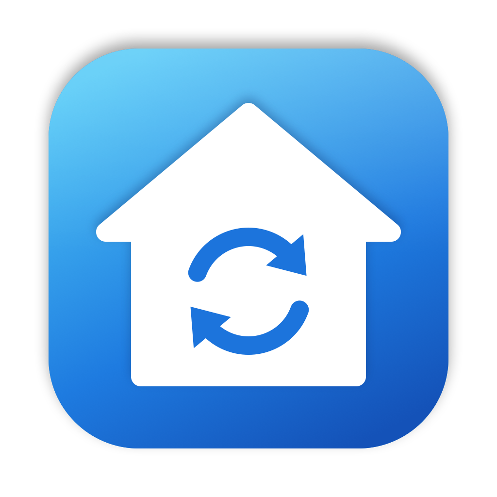

<p align="center"></p>

# HA Sync — macOS → Home Assistant

Two parts:

| Part | Folder | What it does |
|---|---|---|
| **HA Sync.app** | `mac/` | Menu bar app. Reads the Calendar calendars, Reminders lists, Photos albums (your own, iCloud Shared and smart albums) and Notes folders you pick, and pushes them to Home Assistant on a timer. Calendar/Reminders changes also sync within ~10 s. |
| **Mac Sync integration** | `custom_components/mac_sync/` | Custom Home Assistant integration that receives the data and creates entities. |

## What shows up in Home Assistant

All entities sit under one device named after your Mac.

- **Calendar** → a `calendar.*` entity per calendar (works with the Calendar dashboard, automations, and `calendar.get_events`).
- **Reminders** → a `todo.*` entity per list (read-only: changes go one way, Mac → HA).
- **Notes** → a `sensor.*` per folder. The state is the note count; the `notes` attribute lists each note's `title`, `body` (plain text, trimmed) and `modified`. The note text is not saved to the recorder history.
- **Photos** → JPEGs (resized, location and other metadata removed) written to `/media/mac_sync/<album>/`, plus a `sensor.*` per album with the photo count and `media_content_id`. Browse them in **Media → My media → mac_sync**, or use the folder in a slideshow card or a picture-frame integration. When a photo is removed from an album it is deleted from HA; when a photo is edited, HA gets the new version.
- `sensor.<mac>_last_sync` (diagnostic).
- Every push fires a `mac_sync_updated` event.

## Setup

### 1. Home Assistant
1. Install with HACS: **HACS → ⋮ → Custom repositories**, add `https://github.com/bisman-automations/ha-sync` as an **Integration**, then download **Mac Sync**. Or copy `custom_components/mac_sync` to `/config/custom_components/mac_sync` yourself.
2. Restart Home Assistant.
3. **Settings → Devices & services → Add integration → Mac Sync**.
4. In your profile (admin user): **Security → Long-lived access tokens → Create token**. Copy it.

### 2. Mac
```bash
cd mac && ./build.sh
```
```bash
cp -R "mac/build/HA Sync.app" /Applications/
```
Open **HA Sync**, then click the house icon in the menu bar and choose **Settings…**:
1. **Home Assistant** tab: enter the URL and token, then click **Test Connection**. If you like, turn on **Launch at login**.
2. In the **Calendar / Reminders / Photos** tabs, click **Grant Access**, then tick what you want to sync.
3. In the **Notes** tab, click **Load Folders from Notes**. Approve the "control Notes" prompt, then tick folders.
4. Click **Sync Now**.

Requires macOS 14+ and Xcode / Command Line Tools to build.

## Notes & limits
- **Notes** has no public API, so the app reads it through AppleScript/JXA. If access was denied, re-enable it under System Settings → Privacy & Security → Automation → HA Sync → Notes. Locked notes sync without a body.
- **Shared albums** come from iCloud. The first sync downloads the originals, which can take a while for big albums. Use "Newest photos per album" to cap how many are synced.
- Videos are skipped. Live Photos are synced as their still image.
- The app icon is generated by `swift assets/logo.swift assets/logo.png`.
- The app is ad-hoc signed. After rebuilding, macOS may ask for permissions again.
- Sync is one-way, Mac → HA. Deselecting a calendar, list, folder or album makes its entity unavailable, and you can delete it in HA. Deselected albums' photo folders are removed.

## API (if you want to push from something else)
- `GET  /api/mac_sync/push` → `{"ok": true, "version": "1.0.0"}`
- `POST /api/mac_sync/push` with JSON `{source, calendars?, reminders?, notes?, albums?}`. A section you leave out is left unchanged. The response is `{"ok": true, "missing": {"<album-slug>": ["file.jpg", …]}}`.
- `POST /api/mac_sync/photo`, multipart with the fields `album`, `filename` and `file`.

Both need `Authorization: Bearer <admin long-lived token>`.
